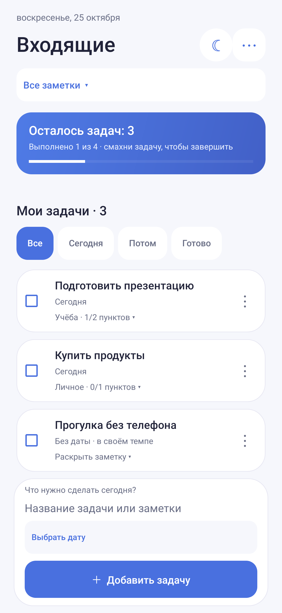
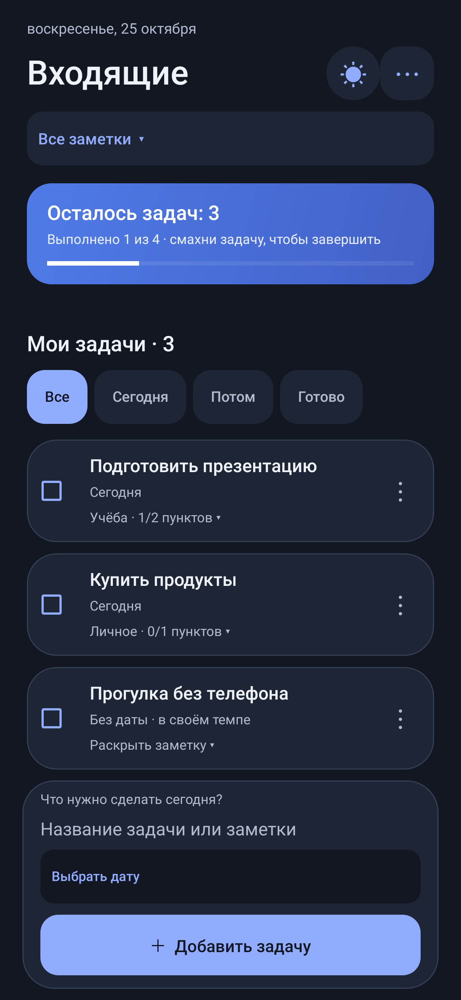
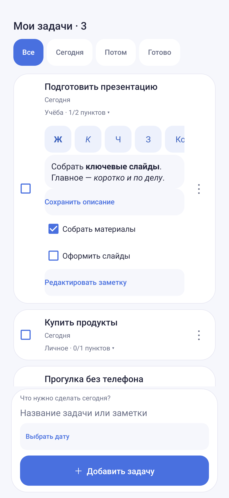
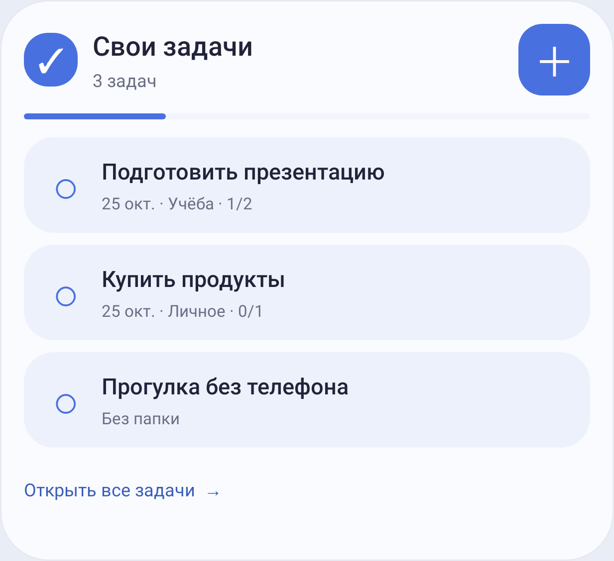

# Свои задачи — локальный аналог TickTick для Android

Независимый open-source планировщик задач и заметок на русском. Альтернатива TickTick для тех, кому нужны списки, папки и напоминания без аккаунта, рекламы и облака. Данные остаются на телефоне. Проект не связан с TickTick и пока не повторяет все его возможности.

## Скриншоты

<p>
  
  
  
</p>


Изображения получены из настоящих Android Views в native-graphics тестах Robolectric. В них только демонстрационные данные; это не снимки личных заметок и не проверка работы на OnePlus.

## Возможности

- Входящие, задачи на сегодня, предстоящие и выполненные.
- Добавление одной строкой: `Позвонить завтра в 18:00`, `Чай через 2 минуты`, `Оплатить связь 5 ноября`.
- Ежедневные и еженедельные повторы.
- Завершение смахиванием, отмена последнего завершения и быстрый перенос времени.
- Уведомления с действиями «Готово» и «Через 10 минут».
- Настройки и проверка напоминаний прямо в приложении.
- Папки с собственными названиями, описание заметки и чек-листы с отдельными галочками.
- Выбор даты в календаре и времени на часах, без ввода словами.
- Два виджета рабочего стола: общий список и задачи на сегодня.
- Светлая, тёмная и системная темы с сохранением выбора на телефоне.
- Проверка новых версий и скачивание APK из GitHub Releases.
- Округлые карточки и виджеты, переключатель светлой/тёмной темы прямо в заголовке.
- Жирный, курсив, подчёркивание, зачёркивание, моноширинный текст и маркированные списки в описании.

## Заголовок и описание

Первая строка при добавлении — заголовок, последующие строки — описание. Дата распознаётся в начале, середине и конце текста: `Завтра позвонить маме в 9 утра`, `Проверить через час и 30 минут духовку`, `Через пять минут сделать перерыв`.

Нажмите на заголовок карточки, чтобы раскрыть заметку. Внутри можно дописать описание и сохранить его без отдельного окна. Для форматирования выделите фрагмент и выберите стиль на панели. Маркированный список в тексте и чек-лист с галочками — отдельные вещи.

Если дата встречается в описании существующей заметки, приложение предлагает применить её кнопкой **«Сохранить и назначить»**, а не молча меняет старое напоминание. В полном редакторе есть такое же предложение для даты из текста.

## Тема и обновления

**⋯ → Тема приложения** — светлая, тёмная или как в системе. Выбор хранится локально и применяется к приложению и виджетам.

При открытии приложение проверяет GitHub Releases, но не чаще раза в 6 часов. В **⋯ → Обновления** можно проверить новую версию вручную или отключить автопроверку. APK скачивается только по нажатию, через системный диспетчер загрузки, в локальную папку приложения на телефоне. Установка тоже запускается вручную и подтверждается Android.

Перед установкой проверяются SHA-256, имя пакета, версия и подпись APK. С версии 0.4.1 GitHub-сборки подписываются постоянным тестовым ключом, который хранится в GitHub Actions Secrets, а не в исходниках. Подпись дополнительно проверяется перед публикацией. Старые тестовые APK и локальные сборки Android Studio могут иметь другую подпись — не удаляйте приложение с важными задачами при ошибке совместимости.

Задачи, описания, чек-листы, папки и настройки **остаются только на устройстве**. Интернет используется для получения сведений о версии и APK с GitHub; заметки на сервер не отправляются. Без сети планировщик продолжает работать. Скачанные файлы из папки приложения удаляются вместе с приложением.

## Заметки и папки

Нажмите на карточку, чтобы раскрыть описание и чек-лист. Кнопка **«Редактировать заметку»** открывает название, описание, папку, дату, повтор и пункты списка. Пункты отмечаются независимо от завершения всей задачи.

Папки находятся под заголовком «Входящие». Там можно создать папку с любым уникальным названием, а в управлении — переименовать или удалить. Удаление папки не удаляет заметки: они переходят в «Без папки».

**«Выбрать дату»** под полем ввода открывает календарь, затем часы. Для задачи без уведомления выберите **«Без времени»**. Когда поле пустое, над ним сменяются примеры ввода; при наборе текста подсказки скрываются.

## Виджеты

Зажмите свободное место на рабочем столе → **Виджеты → Свои задачи**. Доступны **«Список»** и **«Сегодня»**. В зависимости от размера виджет показывает до пяти задач; «Сегодня» включает и просроченные. Галочка завершает задачу, нажатие на название открывает заметку, плюс — добавление.

После изменения задачи виджеты обновляются автоматически. Смена дня дополнительно проверяется при системном обновлении виджета (примерно раз в 30 минут). Доступность и размеры зависят от лаунчера.

## Что улучшается

Проект развивается: обновляются интерфейс, заметки, виджеты и работа напоминаний. Исправления и новые функции перечислены в [CHANGELOG.md](CHANGELOG.md). Автотесты запускаются перед каждой сборкой; поведение на OxygenOS и в разных лаунчерах всё равно требует проверки на телефоне.

Возможные следующие улучшения:
- [ ] Экспорт, импорт и резервные копии заметок.
- [ ] Поиск по заголовкам и описаниям.
- [ ] Календарный экран и более гибкие повторы.
- [ ] Выбор папки отдельно для каждого виджета.
- [ ] Больше настроек оформления и доступности.

**Не хватает функции или нашли ошибку? [Создайте Issue](https://github.com/iverdiyev/sadachi/issues/new/choose).** Для идеи опишите, что хотите делать и зачем. Для ошибки укажите версию приложения, модель телефона, Android/OxygenOS и шаги воспроизведения. Не публикуйте личные заметки; перед отправкой скриншота закройте личные данные.

## Установка

Скачайте APK в [последнем релизе](https://github.com/iverdiyev/sadachi/releases/latest). Также доступен ZIP **Sadachi-APK** в Artifacts последней успешной сборки [Actions](https://github.com/iverdiyev/sadachi/actions).

Это тестовая сборка с debug-подписью. Если Android сообщает о несовместимой подписи, не удаляйте приложение с важными задачами: удаление сотрёт данные. Для обновления без потерь нужен прежний ключ подписи.

## Напоминания

Время можно указать словами или выбрать кнопкой при добавлении задачи. Дата без времени сохраняется без уведомления.

В меню **⋯ → Напоминания** доступны:

1. Разрешение на уведомления приложения.
2. Доступ к точным таймерам — «Будильники и напоминания» в Android.
3. Мгновенное тестовое уведомление и проверка таймера на 10 секунд.
4. Диагностика с последним событием таймера. Её можно скопировать, если что-то не работает.

На OnePlus при задержках проверьте фоновую работу приложения и ограничения батареи в OxygenOS. Если уведомление видно в шторке, но нет звука или всплывающего баннера, проверьте канал «Напоминания» и режим «Не беспокоить». После принудительной остановки откройте приложение снова: Android блокирует таймеры остановленных приложений.

Если уведомления появляются **только после открытия приложения**, это может быть восстановление пропущенного таймера, а не фоновое срабатывание. Новая диагностика различает эти случаи. Откройте **⋯ → Напоминания → Фоновая работа на OnePlus**, разрешите работу без оптимизации и проверьте фоновую работу в OxygenOS.

При продолжающихся задержках доступен **«Надёжный режим»**: после подтверждения напоминания используют системный API будильника Android. Он может показывать значок и время ближайшего будильника, но приложение не включает мелодию будильника — приходит обычное уведомление. Для этого режима тоже нужен доступ к точным таймерам. Принудительную остановку и запрет уведомлений он не обходит; фактическую доставку на конкретной прошивке нужно проверить с заблокированным экраном.

## Сборка

Нужны JDK 17, Gradle 8.9 и Android SDK 35. Откройте корневую папку проекта в Android Studio либо выполните:

```sh
gradle :app:testDebugUnitTest :app:assembleDebug
```

APK: `app/build/outputs/apk/debug/app-debug.apk`.

Автотесты проверяют разбор дат, системные отступы Android 15, создание задач, заметки, виджеты, темы, метаданные обновлений и доставку уведомлений через Android API в Robolectric. Это не заменяет проверку энергосбережения и системного установщика на конкретном телефоне.

## Ограничения

Android 8.0 и новее. Нет синхронизации, отдельного календарного экрана и экспорта данных. При удалении приложения задачи удаляются. Время доставки уведомлений зависит от разрешений и ограничений Android.

Java · нативный Android UI · локальное хранение в SharedPreferences.

[Изменения](CHANGELOG.md) · [MIT License](LICENSE)
